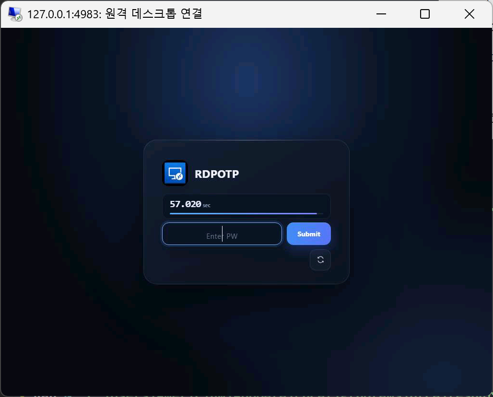
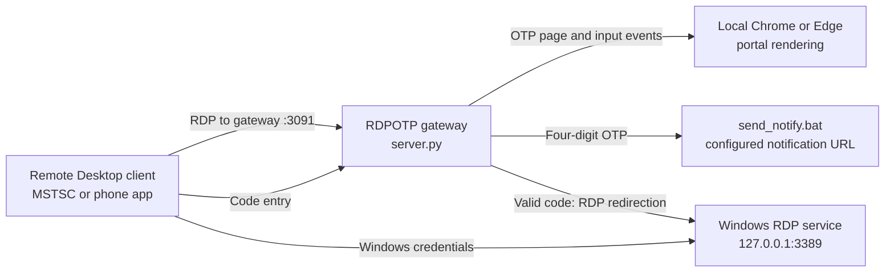

# RDPOTP

RDPOTP is a Windows Remote Desktop gateway that adds a one-time passcode check before handing a client off to the PC's built-in Remote Desktop service. The OTP is an extra gateway check; Windows still asks for a permitted Windows account and its normal credentials after the handoff.

## OTP screen



The screenshot is an example session. Its title bar shows port `4983`; the default gateway port in the current `config.ini` is `3091`.

## How it works



The RDP client connects to the gateway. The gateway displays `pin_portal.html`, rendered by a local Chrome or Edge process, and sends a four-digit code through `send_notify.bat`. After the code is accepted, the gateway redirects the RDP client to the PC's native RDP service. The client then completes the usual Windows sign-in.

## Requirements

- Windows with Remote Desktop enabled and listening on port `3389`.
- Python 3.11 available on `PATH`.
- Google Chrome or Microsoft Edge installed for rendering the OTP page.
- OpenSSL available on `PATH` for first-time certificate generation.
- A notification endpoint, such as a private ntfy topic, to receive OTPs.

Install the Python packages from the project folder:

```powershell
python --version
python -m pip install -r requirements.txt
```

`python --version` should report Python 3.11. Verify OpenSSL with `openssl version`. If it is not found, install OpenSSL, add its `bin` directory to `PATH`, and open a new terminal.

## Configure

Edit `config.ini` before starting the gateway. Restart the gateway after changing settings.

### Notification URL

Set a private writable notification endpoint in the `[notify]` section:

```ini
[notify]
url = https://ntfy.sh/replace-with-a-long-private-topic
```

Replace the example topic with your own hard-to-guess topic. Notifications contain the OTP, and anyone who knows a writable topic URL may be able to publish to it. Keep the real URL private and do not commit a real topic or token. If `url` is empty, OTP notifications cannot be delivered and the server logs a warning.

### Settings reference

| Setting | Default | Description |
| --- | --- | --- |
| `[server] host` | `0.0.0.0` | Interfaces on which the gateway listens. Firewall rules still control access. |
| `[server] port` | `3091` | Port that RDP clients use to reach the gateway. |
| `[server] native_host` | `127.0.0.1` | Address of the PC's built-in RDP service. |
| `[server] native_port` | `3389` | Port of the built-in RDP service. |
| `[server] max_fps` | `10` | Maximum screen updates per second. Set to `0` for no configured cap. |
| `[server] render_scale` | `1.0` | Internal OTP browser capture scale (`0.25` to `1.0`). The default captures at the full negotiated RDP canvas size. Lower values reduce detail and capture work but do not guarantee lower encoded network traffic. |
| `[server] bitmap_chunk_bytes` | `4096` | Target maximum encoded bitmap update size in bytes. Smaller batches help clients on slow links. |
| `[server] bitmap_compression` | `max` | OTP portal mode: `max` (16-bpp RGB565 + RLE), `standard`/`on` (24-bpp + RLE), or `off` (24-bpp uncompressed). |
| `[server] nscodec_surface_updates` | `false` | Enables NSCodec Surface Bits for the OTP portal. Keep disabled for reliable MSTSC tile rendering. |
| `[server] graphics_codec` | `auto` | `auto` uses AVC420 only after client GFX, DRDYNVC, and RDPGFX capability negotiation succeeds; `h264` requests that same gated path; `bitmap` disables GFX and keeps bitmap updates. Unsupported clients and failed negotiation fall back to bitmap updates. |
| `[server] band_delay` | `0` | Optional delay in seconds between screen bitmap bands. |
| `[server] redirect_drain_seconds` | `15` | Maximum time the gateway waits for the client to close after redirection. |
| `[server] disable_hybrid_ex` | `false` | Disables the Hybrid-Ex RDP negotiation path when set to `true`. Normally leave unchanged. |
| `[otp] ttl_seconds` | `60` | OTP lifetime in seconds. Allowed range: 5 to 600. |
| `[otp] max_attempts` | `3` | Incorrect code entries allowed per connection. |
| `[otp] max_sends` | `5` | OTP sends allowed per client address in the send window. |
| `[otp] send_window_seconds` | `600` | Rolling OTP send-rate window in seconds. |
| `[routing_ticket] ttl_seconds` | `900` | Lifetime of a successful OTP handoff ticket in seconds. |
| `[routing_ticket] max_uses` | `16` | Maximum uses of a handoff ticket during its lifetime. |
| `[routing_ticket] bind_source` | `false` | When `true`, requires the handoff to come from the same client address that passed OTP. Keep `false` if the client may change networks. |
| `[notify] url` | empty | Private notification destination used by `send_notify.bat`. |

Supported environment variables override their matching `config.ini` values. Examples include `RDP_PORT`, `RDP_OTP_TTL_SECONDS`, and `RDP_NOTIFY_URL`.

The OTP portal defaults to 16-bpp RGB565 output and standard RDP bitmap RLE,
falling back to an uncompressed bitmap when RLE would be larger. This keeps the
requested resolution and reduces portal color precision. Set
`bitmap_compression = standard` for sharper portal colors, or `off` to disable
portal RLE. After the OTP handoff, the native Windows RDP connection negotiates
display settings with the client; this portal-only setting does not change the
PC desktop's RDP configuration.
`nscodec_surface_updates = false` keeps the tested legacy bitmap path; enabling
it opts into the NSCodec Surface Bits path, which can leave missing tiles in
MSTSC. `graphics_codec = auto` keeps the bitmap path unless the
client advertises Graphics Pipeline support, joins `drdynvc`, and confirms an
AVC420-capable RDPGFX capability set. Set it to `bitmap` to force the legacy
graphics path. `h264` still requires every client capability check and falls
back to bitmap updates when any check fails.
For a slower link, set `[server] max_fps = 5` to limit portal updates. Leave
`band_delay = 0`.
The default `[server] render_scale = 1.0` captures at the negotiated desktop
size. Lower values reduce capture work but still produce the same RDP canvas;
encoded network traffic depends on image content and codec compression. Smaller
`bitmap_chunk_bytes` values can reduce per-packet stalls on very slow links.

## Start the gateway

1. Sign in to the Windows account whose desktop you want to access.
2. Enable Windows Remote Desktop and confirm the native service listens on port `3389`. RDPOTP does not enable Windows RDP or create a Windows account.
3. Install the Python packages and OpenSSL described above.
4. Set the private notification URL in `config.ini`.
5. Double-click `run.bat`. It creates the certificate pair if needed, reads the configured gateway port, and starts `server.py` in a separate command window. If that port is already listening, it reports that the gateway is already running.
6. Keep the server command window open while using RDPOTP. If startup fails, check `server.log` and the command window.

`run.bat` starts only the gateway. It does not launch MSTSC or execute an `.rdp` file.

## Connect

On the same PC, open Remote Desktop Connection (`mstsc`) and connect to:

```text
127.0.0.1:3091
```

For a device on the same LAN, connect to the PC's LAN address and configured gateway port, for example `192.168.1.20:3091`. Use the actual address assigned to the PC. Allow inbound TCP traffic on the gateway port in Windows Firewall only for the network profile and client devices that need access. Do not expose the gateway directly to the public internet.

The gateway sends an initial OTP when the page opens. If needed, select **Resend**; resend requests are rate limited. Enter the code and select **Submit** before the countdown expires. After a valid code, the RDP client is redirected to the native Windows service and prompts for normal Windows credentials. If you change the gateway port, use the new port in both the client address and firewall rule.

## Certificates

`generate_cert.bat` creates a one-year self-signed certificate (`rdp.crt`) and private key (`rdp.key`) for `localhost` and `127.0.0.1`. `run.bat` calls it automatically. A complete existing pair is left unchanged. If only one file exists, generation stops rather than overwriting part of the pair. Review or remove the incomplete pair, then run the generator again.

Because the generated certificate is self-signed, an RDP client may show a certificate trust warning. The certificate is only valid for `localhost` and `127.0.0.1`; for LAN access by hostname or IP, use a certificate trusted by your clients whose subject alternative name includes that hostname or IP. Never share or commit `rdp.key`.

## Troubleshooting

### Python or a package is missing

Confirm Python 3.11 is on `PATH`, install packages with `python -m pip install -r requirements.txt`, and check `python --version` in a new terminal.

### Certificate generation fails

Run `openssl version`. Install OpenSSL or add its `bin` directory to `PATH`. Confirm that `rdp.crt` and `rdp.key` either both exist or both do not exist.

### The gateway port is already in use

Close the existing RDPOTP server or change `[server] port` in `config.ini`. Connect MSTSC to the same updated port.

### MSTSC cannot connect

Confirm the server command window is still running, MSTSC uses the configured gateway port (default `3091`), and Windows Firewall allows that TCP port from the client device. For LAN connections, use the PC's LAN address rather than `127.0.0.1`.

### No OTP notification arrives

Confirm `[notify] url` contains the correct private endpoint and the PC can reach it. Check `server.log` for notification configuration, rate-limit, or delivery warnings. Do not paste the real URL into public logs or issue reports.

### OTP is accepted but Windows sign-in fails

The OTP only authorizes the handoff; Windows still performs its normal Remote Desktop authentication. Confirm that Remote Desktop is enabled, the native service is listening at `[server] native_host` and `[server] native_port`, and the account is allowed to sign in through Remote Desktop.

## FAQ

### What is RDPOTP?
RDPOTP is a free, open-source, self-hosted OTP (one-time password) gateway for
Windows Remote Desktop (RDP / MSTSC). It adds a disposable 4-digit passcode check
before handing the RDP client off to the PC's built-in Remote Desktop service,
acting as a lightweight two-factor authentication (2FA) layer in front of Windows
RDP. Windows still enforces its normal account and password authentication after
the handoff.

### How do I add 2FA / OTP to Windows Remote Desktop?
Install RDPOTP on the Windows PC, set a private notification URL in `config.ini`,
run `run.bat`, and point your RDP client at the gateway port (default `3091`).
Each connection must enter a fresh 4-digit code before reaching the native
Windows RDP service.

### Does RDPOTP replace Windows authentication?
No. RDPOTP adds an extra gateway check; Windows still performs its normal
Remote Desktop authentication (account + password / NLA) on the native service.

### Is RDPOTP free and open source?
Yes. RDPOTP is released under the MIT license and runs entirely on your own
Windows PC with no cloud dependency.

### Can I use RDPOTP from my phone or another PC?
Yes. Any standard RDP client (MSTSC, Microsoft Remote Desktop mobile app,
FreeRDP, etc.) can connect to the gateway address and port.

## Runtime data and privacy

`server.log` contains runtime diagnostics. `client_viewports.json` stores viewport dimensions associated with client addresses. These are local runtime files and are excluded by `.gitignore`. Do not commit runtime logs, client address data, generated certificates, private keys, real notification URLs, or saved `.rdp` profiles.
