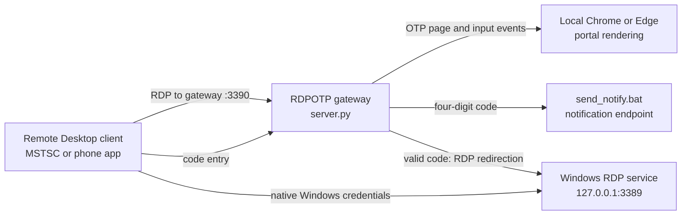

# RDPOTP

RDPOTP is a Windows Remote Desktop gateway. It shows a one-time-password page to an incoming RDP client, sends a four-digit code to a configured notification endpoint, and redirects the client to the PC's native Remote Desktop service after the code is accepted. The Windows account password is still required by native RDP; the OTP is an additional gateway check.

## How the components fit together



The gateway listens on the port configured in `config.ini` (default `3390`). `server.py` handles the RDP connection, OTP challenge, client input and redirection. The OTP page is `pin_portal.html`; a local Chrome or Edge process renders it and returns the screen to the RDP client. `portal.py` creates and checks OTPs and limits code attempts and sends. `send_notify.bat` posts the OTP to the URL supplied by `[notify] url`. Once verified, the gateway sends an RDP redirection to the native service at `127.0.0.1:3389`. The RDP client then connects to that service and authenticates with a Windows account.

## Requirements

- Windows with Remote Desktop enabled and listening on port `3389`.
- Python 3.11 available on `PATH`.
- The Python dependencies listed in `requirements.txt`.
- Google Chrome or Microsoft Edge installed for rendering the OTP page.
- OpenSSL available on `PATH` to create the initial TLS certificate and key.
- A notification endpoint, such as a private ntfy topic, to receive OTPs.

Open PowerShell in the project folder and install the dependencies:

```powershell
python --version
python -m pip install -r requirements.txt
```

`python --version` should report Python 3.11. Check OpenSSL with `openssl version`. If it is not found, install OpenSSL and add its `bin` directory to `PATH`, then open a new terminal.

## Configure

Edit `config.ini` with a text editor. The server reads it at startup, so stop and restart the gateway after changes.

### Notification endpoint

Set a private writable endpoint under `[notify]`:

```ini
[notify]
url = https://ntfy.sh/replace-with-a-long-private-topic
```

Replace the example topic with your own hard-to-guess topic. Keep the real URL private: anyone who knows a writable topic URL may be able to publish to it, and notifications contain the OTP. Do not commit a real topic or token. If `url` is blank, the gateway cannot deliver codes and writes a warning to `server.log`.

### Server and OTP settings

| Setting | Default | Meaning |
| --- | --- | --- |
| `[server] host` | `0.0.0.0` | Network interfaces on which the gateway listens. `0.0.0.0` allows connections on all interfaces; firewall rules still control access. |
| `[server] port` | `3390` | Port used by the RDP client to reach the OTP gateway. |
| `[server] native_host` | `127.0.0.1` | Address of the PC's actual Windows RDP service. |
| `[server] native_port` | `3389` | Port of the actual Windows RDP service. |
| `[server] max_fps` | `30` | Maximum screen updates per second. Set to `0` for no configured cap. |
| `[server] band_delay` | `0` | Optional delay in seconds between screen bitmap bands. |
| `[server] redirect_drain_seconds` | `15` | Maximum time the gateway waits for the client to close after redirection. |
| `[server] disable_hybrid_ex` | `false` | Disables the Hybrid-Ex RDP negotiation path when set to `true`. Leave at the default unless troubleshooting compatibility. |
| `[otp] ttl_seconds` | `60` | OTP lifetime in seconds; allowed range is 5 to 600. |
| `[otp] max_attempts` | `3` | Incorrect OTP entries allowed on one connection. |
| `[otp] max_sends` | `5` | Maximum initial or resent OTPs per client address in the configured window. |
| `[otp] send_window_seconds` | `600` | Rolling rate-limit window for OTP sends, in seconds. |
| `[routing_ticket] ttl_seconds` | `900` | Lifetime of a successful OTP handoff ticket, in seconds. |
| `[routing_ticket] max_uses` | `16` | Maximum uses allowed for the handoff ticket during its lifetime. |
| `[routing_ticket] bind_source` | `false` | If `true`, only the source address that passed OTP can use the handoff ticket. Leave `false` if a phone or client may change networks during connection. |
| `[notify] url` | empty | Private notification destination used by `send_notify.bat`. |

Environment variables override supported configuration values when present. Examples include `RDP_PORT` for `[server] port`, `RDP_OTP_TTL_SECONDS` for `[otp] ttl_seconds`, and `RDP_NOTIFY_URL` for `[notify] url`.

## Start the gateway

1. Sign in to the Windows account whose desktop you want to access.
2. Enable Windows Remote Desktop and confirm the native service is listening on port `3389`. The gateway does not enable Windows RDP or create a Windows account.
3. Install the Python packages and OpenSSL as described above.
4. Set the private notification URL in `config.ini`.
5. Double-click `run.bat`. It generates the certificate pair if needed, checks the configured gateway port, and starts `server.py` in a separate command window. If that port is already listening, it reports that the gateway is already running.
6. Keep the server command window open while using the gateway. Check `server.log` if startup fails.

`run.bat` only starts the gateway. It does not start MSTSC or run an `.rdp` file.

## Connect with Remote Desktop

On the same PC, open Remote Desktop Connection (`mstsc`) and connect to:

```text
127.0.0.1:3390
```

For another device on the LAN, connect to the Windows PC's LAN address and gateway port, for example `192.168.1.20:3390`. Use the actual address assigned to your PC. In Windows Firewall, allow inbound TCP traffic on the configured gateway port only on the network profiles and from the devices that should have access. Do not expose the gateway directly to the public internet.

The gateway displays the RDPOTP page and automatically sends an initial code to the configured notification endpoint. If needed, use **Resend** to request another code, subject to the send rate limit. Enter the code and select **Submit** before the timer expires. The gateway then redirects the RDP client to the native Windows service. Complete the normal Windows Remote Desktop sign-in when prompted. If you change the gateway port, use that same port in the client address and firewall rule.

## Certificates

`generate_cert.bat` creates a one-year self-signed localhost certificate (`rdp.crt`) and private key (`rdp.key`) using OpenSSL. `run.bat` calls it at startup. If both files already exist, they are left unchanged. If only one exists, generation stops to avoid overwriting part of a certificate pair. Review or remove the incomplete pair yourself, then run the generator again.

The private key `rdp.key` must not be shared or committed. Both generated files are ignored by `.gitignore`; the application can regenerate them on the target PC.

## Troubleshooting

### `run.bat` says Python or a package is missing

Confirm Python 3.11 is on `PATH`, install requirements with `python -m pip install -r requirements.txt`, and run `python --version` in a new terminal.

### Certificate generation fails

Run `openssl version`. Install OpenSSL or add its `bin` directory to `PATH`. Check that `rdp.crt` and `rdp.key` either both exist or both do not exist.

### The gateway port is already in use

Close the existing RDPOTP server or change `[server] port` in `config.ini`. Connect MSTSC to the updated port. `run.bat` uses the configured port when starting the gateway.

### MSTSC cannot connect to the gateway

Confirm that the server window is still running, the client uses the configured gateway port (default `3390`), and Windows Firewall permits that TCP port from the client device. For LAN access, use the PC's current LAN address rather than `127.0.0.1`.

### No notification arrives

Confirm `[notify] url` is set to the correct private endpoint and that the PC can reach it. Check `server.log` for notification configuration, rate-limit, or delivery warnings. Do not paste the real URL into public logs or issue reports.

### OTP succeeds but native RDP sign-in fails

The OTP only authorizes the gateway handoff; Windows still performs its normal Remote Desktop authentication. Confirm that Remote Desktop is enabled, the native service is listening at `[server] native_host` and `[server] native_port`, and the account is allowed to sign in through Remote Desktop.

## Local runtime data and repository hygiene

`server.log` contains runtime diagnostics. `client_viewports.json` stores viewport dimensions associated with client addresses. These are local runtime data and are excluded by `.gitignore`. Do not commit logs, client address data, certificates, private keys, real notification URLs, or saved `.rdp` profiles.
